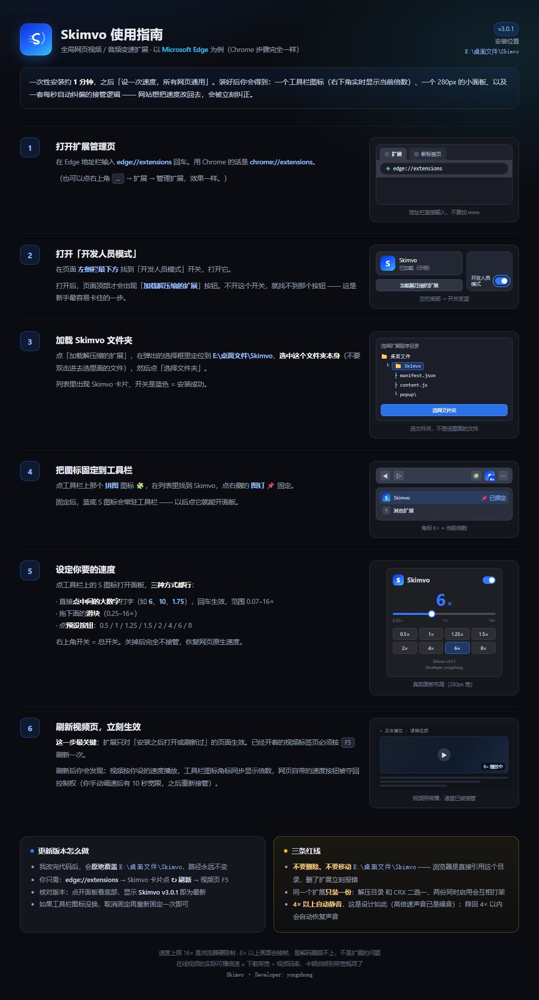

# Skimvo

> 一个速度，全站通用。给所有网页视频 / 音频设统一的播放倍速，设一次，永久生效。

浏览器扩展（Manifest V3，Chrome / Edge 通用）。**零依赖、零构建、不联网**——加载文件夹即用。


## 功能

| 功能 | 说明 |
| --- | --- |
| 全局变速 | 0.07× – 16× 全区间，滑块 / 8 个预设挡位 / 手动输入三种入口 |
| 全站生效 | 所有网页的 `video` / `audio` 自动套用，新标签、刷新、换站点都保持 |
| 反倍速纠偏 | 播放器自行把速度改回去时自动拉回，另加每秒兜底巡检 |
| 工具栏角标 | 图标右下角实时显示当前倍速，暂停接管时显示 ⏸ |
| 高倍率静音 | 超过 4× 自动静音（刷画面不留噪音），降回 4× 内自动恢复 |
| 手动宽限 | 检测到你在播放器里手动调速，10 秒内不干预 |
| 跨设备同步 | 设置存 `chrome.storage.sync`，登录浏览器账号即同步 |

## 安装（Edge 为例，Chrome 同理）

1. 地址栏输入 `edge://extensions`（Chrome 是 `chrome://extensions`）
2. 打开「开发人员模式」
3. 点「加载解压缩的扩展」，选择本目录
4. 工具栏拼图图标 → 把 Skimvo 固定出来

图文流程见 [docs/guide.html](docs/guide.html)，或直接看长图：



## 使用

点工具栏图标弹出面板：

- **大数字**可直接点击输入，支持 `1.75`、`12` 这类精确值，回车生效
- **滑块** 0.25× – 16× 粗调，**预设** 8 个常用挡位一键直达
- 右上角开关暂停接管（恢复浏览器原速 1×）

## 技术实现

不依赖任何框架与构建工具，共 6 个文件：

```
manifest.json     # MV3 清单
content.js        # 核心：接管 playbackRate、纠正网页重置、高倍率静音
background.js     # service worker：仅用于维护工具栏角标
popup/            # 面板：滑块 / 预设 / 输入框 / 开关
icons/            # 16 / 48 / 128（另有 512 母版）
```

接管逻辑的四个要点：

1. **侵入点**：监听捕获阶段的 `ratechange`，判断是网页改的还是本扩展改的（`applying` 标志位区分）
2. **对抗重置**：网页非用户操作地改速度 → 立即纠正回目标值
3. **用户优先**：最近 1 秒内有点击/按键/滚轮，视为用户手动调速，进入 10 秒宽限期
4. **兜底巡检**：每秒遍历一次所有媒体元素，覆盖「宽限期结束后不再触发事件」「脚本注入晚于媒体创建」两个死角

设置变更通过 `chrome.storage.onChanged` 实时下发到所有已打开页面，无需刷新。

## 已知边界

- **DRM 流媒体**（Netflix 等）无法接管，所有同类扩展的共同限制
- **在线视频的实际倍速受带宽限制**：播放消耗数据的速度超过下载速度时会反复缓冲，观感上「上不去」，这是物理瓶颈
- **4× 以上声音**浏览器会压掉或变成噪音，故本扩展在 4× 以上直接静音
- **Shadow DOM 内的播放器**暂未覆盖（当前用 `document.querySelectorAll` 遍历）

## 许可

**专有软件，不提供源代码。** 个人非商业用途免费；商业用途需授权（hongyongzhong2020@126.com）；禁止修改后分发、禁止作为自有作品重新发布。详见 [LICENSE](LICENSE)。

Developer: yongzhong
