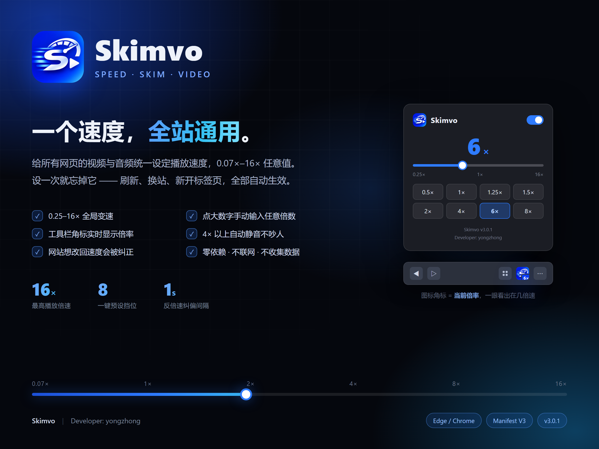

# Skimvo

> 全局网页视频 / 音频变速扩展。源码在本仓库，安装包发布在
> [Skimvo-releases](https://github.com/gityongzhong/Skimvo-releases)。

- 形态：浏览器扩展（Chrome / Edge 通用，Manifest V3）
- 技术栈：原生 JS + WebExtension API，**零依赖、零构建**，无 package.json、无 npm
- 当前版本：`3.0.1`（版本号以 `manifest.json` 为准）
- 许可：[MIT](LICENSE)（可自由使用、修改、分发，请保留版权声明）



## 目录结构

```
manifest.json     MV3 清单：权限仅 storage，action 指向 popup
content.js        核心逻辑：接管 playbackRate、纠正网页重置、高倍率静音、兜底巡检
background.js     service worker：只负责维护工具栏角标（不常驻，不占资源）
popup/            面板：popup.html / popup.css / popup.js
icons/            16 / 48 / 128 + 512 母版（512 只作源图，不进 manifest）
docs/guide.html   图文使用指南（Edge 为例，纯 CSS 画示意图，可渲染成长图）
docs/intro-4x3.html  4:3 介绍图（1200×900 固定画布，GitHub 展示用）
assets/           由上面两个 html 渲染出的成品图
```

## 核心逻辑（content.js）

四个要点，改代码时别破坏：

1. **侵入点**：捕获阶段监听 `ratechange`。`applying` 标志位区分「本扩展改的」与「网页改的」，
   避免自触发死循环。
2. **对抗重置**：网页非用户操作地改速度 → 立刻纠正回目标值。
3. **用户优先**：最近 1 秒内有点击 / 按键 / 滚轮，视为用户在播放器里手动调速，
   进入 **10 秒宽限期**（`MANUAL_GRACE_MS`），期间不干预。
4. **兜底巡检**：`setInterval(applyAll, 1000)`。这块不能删——它覆盖两个死角：
   宽限期结束后页面不再触发任何事件；以及脚本注入晚于媒体元素创建。

速度钳制在 `[0.0625, 16]`（浏览器 `playbackRate` 合法区间，越界个别实现会抛错）。
超过 4×（`MUTE_ABOVE`）自动静音，降回 4× 内只恢复「自己静掉的」（`mutedByUs` WeakSet），
不动用户手动的静音。

`background.js` 只做一件事：`chrome.storage.onChanged` → `chrome.action.setBadgeText`。
设置变更靠 `storage.onChanged` 直接下发到所有已打开页面，**不需要消息中转、不需要刷新页面**。

## 本地调试

1. `chrome://extensions`（Edge：`edge://extensions`）→ 打开开发人员模式
2. 「加载已解压的扩展程序」→ 选本目录
3. 改完代码 → 扩展卡片点 **↻** → 视频页 **F5**
4. 面板底部 `Skimvo vX.Y.Z` 是版本核对锚点，显示对不上就是没刷新成功

## 发布流程

```bash
# 1. 改 manifest.json 的 version，提交
# 2. 打纯净包（只含扩展文件，不带 README / docs / assets）
python - <<'EOF'
import zipfile, os
z = zipfile.ZipFile('Skimvo-vX.Y.Z.zip', 'w', zipfile.ZIP_DEFLATED)
for root, _, files in os.walk('Skimvo'):
    for f in files:
        p = os.path.join(root, f)
        z.write(p, p.replace(os.sep, '/'))
z.close()
EOF

# 3. 可选：签名 CRX（需 Chrome 打包器）
#    chrome.exe --pack-extension=<dir> --no-message-box --user-data-dir=<tmp>
```

然后到 [Skimvo-releases](https://github.com/gityongzhong/Skimvo-releases)：替换 zip、改版本号、发 Release。

**私钥与打包产物不入库**（见 `.gitignore`）：`*.pem` 丢失会导致以后 CRX 的扩展 ID 变化，
`*.crx` / `*.zip` 放 releases 仓库，不占源码仓库体积。

## 版本记录

| 版本 | 变更 |
| --- | --- |
| 1.0.0 | 首个可用版本（当时叫 SpeedDial）：全局变速 0.25–4×、预设、开关 |
| 1.1.0 – 1.2.1 | 上限提到 8×；预设改两行；补每秒兜底巡检（修「加速不了」） |
| 1.3.0 | 大数字可点击输入，区间放宽到 0.07–16× |
| 2.0.0 | 改名 Velox，换品牌图标，面板加品牌头 |
| 2.1.0 | 加 `background.js`，工具栏角标实时显示倍速 |
| 2.2.0 | 滑块上限统一到 16×（此前滑块 8× / 输入 16× 不一致） |
| 2.3.0 | 4× 以上自动静音（刷课场景）；加版本号显示；加署名行 |
| 2.3.3 – 2.3.8 | 换 LOGO；面板圆角折腾（结论见下）；改品牌蓝 |
| 2.4.0 – 2.4.4 | 配色回调为「暗底 + 品牌蓝点缀」；预设定为 0.5/1/1.25/1.5/2/4/6/8 |
| 3.0.0 | 改名 Skimvo（原名撞车 Chrome 商店已有扩展），目录同步更名 |
| 3.0.1 | 换 S 形 LOGO；接入 GitHub 私有仓库 + 公开 releases |

## 踩过的坑

- **弹窗圆角**：Chrome 扩展弹窗是浏览器绘制的矩形窗口，官方明确回复不会开放形状定制
  （Chromium issue 40852436）。真圆角必然露出窗口白底四角，二选一，现取「方角 + 无白边」
  （`html` 画布刷成面板同色）。
- **交付方式**：早期每次更新都「删目录 + 重新复制」，导致浏览器引用的路径失效、注入失败。
  现在一律**原地覆盖文件**，桌面目录 `E:\桌面文件\Skimvo` 路径固定不动。
- **git push 被代理拦**：本机出网代理间歇性返回 502。若 `git push` 反复失败，
  改用 GitHub Git Database REST API 通道（见 ofd-viewer 仓库的 `tools/sync_github.py`）。
- **代码本来就是明文**：`.crx` / `.zip` 内是明文 JS，解包即可读，索性直接开源。
